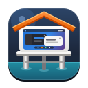

<p align="center">
  
</p>

# Piloti Desktop

A Linux Wayland desktop shell built on [Domicile](https://domicile-desktop.com/) with an **Adwaita / GNOME** design system.

## Features

- **Wayland Window Management**: Renders native Wayland clients (`<app app-id="…" />`) with `xdg_toplevel` state synchronization (`Maximized`, `Fullscreen`, `Tiled*`), client-initiated `Move` / `Resize` / `Minimize`, `Alt`/`Super` + drag, 8-edge resizing, edge snapping, and per-app geometry memory.
- **Unified Menu bar**: Dynamic application menu, Overview switcher, live screen-capture indicator pill, DBusMenu System Tray, `Launcher`, and `ControlPanel` unified under a single non-modal menu bar.
- **Dock & Desktop Icons**: Magnifying app dock with macOS-style slide-in entrance, XDG Trash status + actions, and a transparent spatial `DesktopIconsApp` for `~/Desktop` with rubber-band selection, drag placement, and 2D keyboard navigation.
- **Notifications & History**: FreeDesktop-compatible toast banners with urgency timeouts, Do Not Disturb, lock screen privacy rules, and persistent notification history in `ControlPanel`.
- **GNOME Adwaita Styling**: Light and dark modes, official Libadwaita 1.6 accent colors, GNOME `org.gnome.desktop.background` wallpapers (including `.jxl` transcode + host downscaling), solid wallpapers, and custom background images.
- **XDG & GNOME Integration**: Standards-compliant FreeDesktop `.desktop`, `index.theme`, Base Directory, Trash, and Session Management modules with two-way `GSettings` sync, PipeWire (`wpctl`/`pactl`), NetworkManager (`nmcli`), UPower, Web Battery API fallback, `powerprofilesctl`, and XDG Desktop Portals.
- **Built-in Utilities**: System Settings (`appearance`, `fonts`, `dock`, `notifications`, `wallpaper`, `network`, `sound`, `displays`, `about`) and **DevTools** (CSP-safe JS REPL, live logs persisted to `~/.cache/piloti/piloti.log`, state inspector, and `localStorage` explorer).

## Quick Start

### Browser Development Mode

```bash
bun install
bun run dev
```

Open `http://localhost:5173`. Runs against a local `FakeDomicileHost` harness with simulated apps and hardware controls.

### Native Wayland Session (Linux + Domicile)

```bash
# Run directly from TypeScript source
domicile ./desktop.tsx

# Hot-swap into a running Domicile session
domicile load-shell ./desktop.tsx

# Build standalone bundle
bun run build:shell
domicile ./dist/shell.js
```

### Tests, Typecheck & Build

```bash
bun test
bun run typecheck
bun run build
```

## Keyboard Shortcuts

| Shortcut | Action |
| :--- | :--- |
| `Alt + Space` / `Meta + K` | Toggle Launcher (Search apps, windows, actions, URLs) |
| `Alt + Tab` / `Alt + Shift + Tab` | Cycle open windows with live thumbnails |
| `Meta + ↑` / `F3` | Toggle Overview |
| `Print` | Take interactive screenshot |
| `Meta + Return` | Launch terminal (`kitty`) |
| `Alt + ,` | Open System Settings |
| `Alt + N` | Toggle Control panel & Notifications |
| `Alt + [` / `Alt + ]` | Tile focused window left / right |
| `Alt + F` | Maximize / restore focused window |
| `Alt + M` | Minimize focused window |
| `Alt + W` | Close focused window |

## Documentation

- **[Architecture & Shell API (`docs/ARCHITECTURE.md`)](./docs/ARCHITECTURE.md)** — Runtime model, directory structure, and APIs for querying/controlling apps, windows, and settings.
- **[Debian / VMware Guide (`docs/VMWARE-DEBIAN-GUIDE.md`)](./docs/VMWARE-DEBIAN-GUIDE.md)** — Running and hot-reloading Piloti inside a Debian VM with Domicile.
- **[Project Website (`docs/index.html`)](./docs/index.html)** & **[Web Demo (`docs/demo/`)](./docs/demo/)**.
